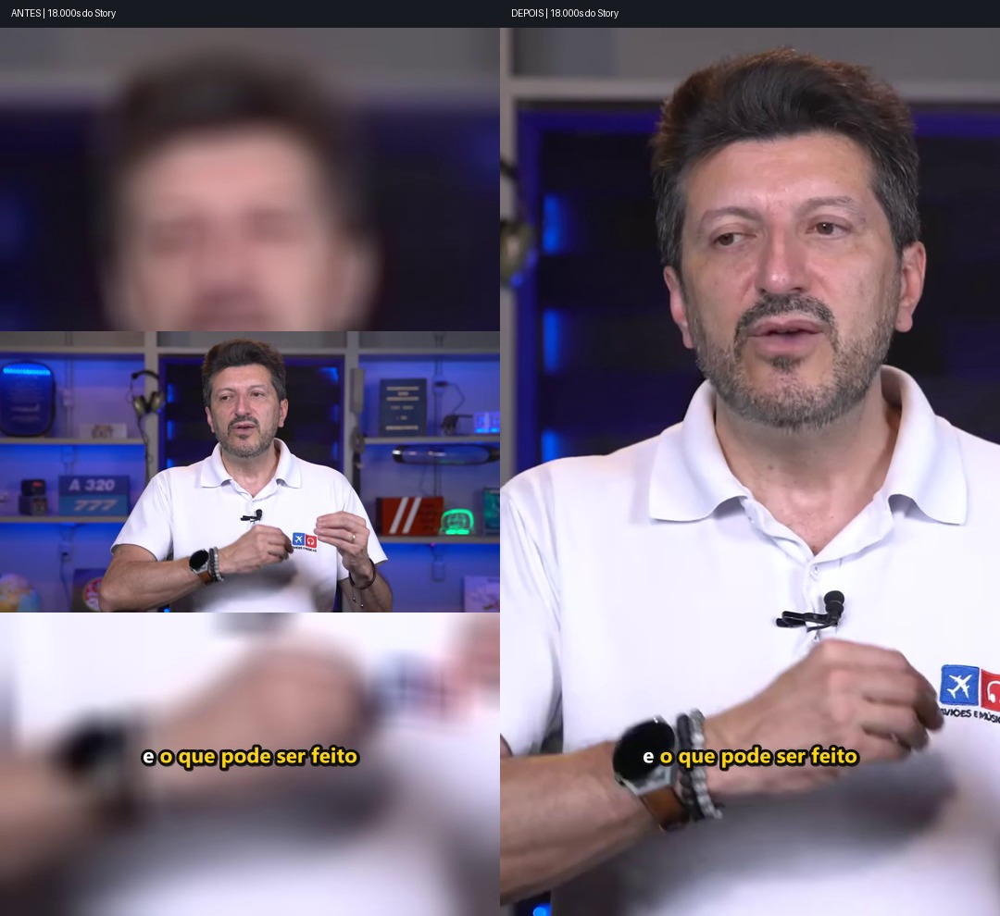

# Entrega ? acabamento de c?mera e prote??o do Curator

15/10/2026 ? America/Sao_Paulo

O refinamento incremental est? implementado. Foram preservados o motor de legendas, t?tulos editoriais, janelas, ordem narrativa e projetos originais. A nova c?mera s? ? aplicada por uma revis?o expl?cita; nenhuma aprova??o foi concedida e nenhum lote completo foi disparado por este trabalho.

## Demonstra??es reais

Os dois MP4s t?cnicos abaixo t?m 1080?1920 e usam o original do Lito. N?o s?o finais aprovados. O apresentador ocupa o 9:16 entre aproximadamente 14,18 e 24,19 s do Story (fonte 2029,28?2039,29 s); o in?cio permanece amplo porque a evid?ncia n?o autoriza crop.

- [Apresentador ? MP4 1080?1920](demos_hd_final/apresentador/DEMO_APRESENTADOR_1080x1920.mp4)
- [Mapa rota ? MP4 1080?1920](demos_hd_final/mapa_rota/DEMO_MAPA_ROTA_1080x1920.mp4)

Cinco pr?vias 540?960, em projeto derivado separado:

| Cen?rio | Fonte original (s) | Dura??o editorial | Pr?via e comparativo |
| --- | --- | --- | --- |
| Apresentador: busto vertical + zoom suave | 2015.10?2045.00 | 29.90 s | [MP4](demos_final/review_project/serie_s03/016_PROP_f47b1a26cfc3a496c457c437/cd6d32aa00924976/preview/PREVIEW_540x960.mp4) ? [antes/depois](demos_final/apresentador/comparativo_01.jpg) |
| Mapa/rota: composi??o ampla | 422.54?448.60 | 26.06 s | [MP4](demos_final/review_project/serie_s01/002_PROP_0cd8967b4785b114a6b605c0/36022897014b5419/preview/PREVIEW_540x960.mp4) ? [antes/depois](demos_final/mapa_rota/comparativo_01.jpg) |
| Apresentador/mapa: preservar mudan?as da fonte | 793.20?837.86 | 44.66 s | [MP4](demos_final/review_project/serie_s02/004_PROP_820da3ee0287202220af0541/39abc30b5df7478f/preview/PREVIEW_540x960.mp4) ? [antes/depois](demos_final/alternancia/comparativo_01.jpg) |
| Gestos: composi??o ampla | 972.12?1009.26 | 37.14 s | [MP4](demos_final/review_project/serie_s02/006_PROP_f5106b486d19e3c2e8be43ca/4ee7abc6679cfa2b/preview/PREVIEW_540x960.mp4) ? [antes/depois](demos_final/gestos/comparativo_01.jpg) |
| Sem metadados fornecidos: fallback | 358.54?384.76 | 26.22 s | [MP4](demos_final/review_project/serie_s01/001_PROP_f654d728d26180f2fb0e5816/3af4f090770a5527/preview/PREVIEW_540x960.mp4) ? [antes/depois](demos_final/baixa_confianca/comparativo_01.jpg) |



[Sequ?ncia da transi??o real](TRANSICAO_REAL.jpg) ? [m?tricas e planos completos](demos_final/VALIDACAO_REAL.json) ? [ensaios HD](demos_hd_final/HD_DEMOS.json).

## O que mudou

- Foco visual por persist?ncia e geometria; uma pessoa n?o ? identificada como falante apenas por estar no centro. Jitter isolado deixa de bloquear a cena inteira. Propostas curtas de crop s?o suprimidas e gaps voltam imediatamente ? fonte ampla.
- Zoom adicional opcional de 3,5%, com easing, hold inicial e limites de geometria/nitidez/resolu??o. N?o reinicia por legenda ou frase. ? configur?vel e pode ser desligado.
- Entrada suave de 0,35 s na composi??o vertical dentro da mesma cena. Usa os mesmos frames, sem sobrepor intervalos, encurtar a timeline ou atravessar cortes da fonte. Tamb?m pode ser desligada.
- Mapas s? podem receber crop com evid?ncia espacial revisada e r?tulos/rota cabendo na janela. Nenhuma coordenada foi inferida da fala. Nos trechos reais, a composi??o ampla foi preservada.
- Metadados existentes s?o vinculados por SHA256 ao projeto, fonte, intervalo e caminho exato do clip. O snapshot da evid?ncia ? copiado para a nova revis?o.
- Revis?es de c?mera de Stories copiam ASS, SRT, timeline can?nica, t?tulos e capas hist?ricos por hash. Novos planos s?o congelados. Interrup??es deixam a revis?o bloqueada para reabertura; a origem fica intacta.
- Reels usam a mesma API sem an?lise adicional; os campos de zoom/transi??o fazem parte da assinatura de aprova??o. O script de revis?o reutiliza por padr?o a percep??o persistida.
- Limpeza protege originais, output, caches, projetos, revis?es, aprova??es, manifests, backups e Analyzer. Apenas tempor?rios com registro espec?fico e SHA256 podem ser candidatos, fora dessas ?rvores. N?o houve limpeza real.
- Render usa tentativa exclusiva, nomes UUID e publica??o sem sobrescrever destinos. Arquivos de tentativas interrompidas permanecem para inspe??o. O limite editorial controla o encode; a remo??o de -shortest impede truncamento de pacotes finais de ?udio.

## Valida??o

**749 testes passaram; 4 foram ignorados; zero falhas.** [JUnit completo](pytest_delivery.xml). A su?te inclui c?mera, zoom, transi??es, Stories, Reels, raster de karaok?, freeze, aprova??o, persist?ncia, hashes, prote??o de output, instalador, interrup??es e recupera??o. As escritas de testes ficaram em bases exclusivas dentro de `%TEMP%`.

Nos cinco MP4s reais, o PCM decodificado foi id?ntico ao preview hist?rico (mesmas amostras e SHA256); ASS, SRT, t?tulo PNG e digest da timeline can?nica tamb?m s?o id?nticos. Os dois ensaios HD mantiveram PCM id?ntico. [Integridade de ?udio HD](hd_audio_integrity.json).

Foram decodificados **3.932 frames** das cinco pr?vias; nenhuma faixa preta uniforme de quatro pixels foi detectada nas bordas. [Auditoria de todos os frames](all_frames_final.json). Tamb?m houve inspe??o dos 15 comparativos. As dimens?es/fps e limites editoriais est?o registrados por ffprobe; a dura??o de container pode diferir por arredondamento de frame/AAC dentro da toler?ncia j? existente.

Os quatro skips s?o um symlink sem privil?gio Windows (o teste real de junction passou), dois testes dependentes de originais legados ausentes e uma fixture opcional do pacote original do Analyzer. Esses arquivos n?o foram fabricados. As duas premissas antigas de teste de rel?gio foram corrigidas ap?s reproduzir as falhas com o c?digo inicial; o rel?gio e o motor de legendas permaneceram inalterados.

## Preserva??o e concilia??o

Ap?s o usu?rio confirmar o uso simult?neo da GUI, o estado resultante foi inventariado novamente, sem reverter seus novos renders ou aprova??es. A checagem final confirmou **1.641/1.641 arquivos protegidos id?nticos** ao baseline conciliado, al?m do v?deo original e **487/487 evid?ncias externas do Analyzer**. Nenhum arquivo inicial ficou ausente. [Hashes finais](protected_delivery.json) ? [concilia??o e organiza??o](AUDITORIA_ORGANIZACAO.md) ? [prote??o de output](PROTECAO_OUTPUT.md).

Os 133 arquivos do backup inicial tamb?m passaram na verifica??o de SHA256. [Backup verificado](backup_integrity.json). As altera??es locais preexistentes fora dos m?dulos intencionalmente refinados permaneceram id?nticas, incluindo o motor de legendas, a GUI e seus testes. [Compara??o](preexisting_changes_preservation.json).

Os primeiros ensaios foram preservados como evid?ncia: `demos/` cont?m os defeitos detectados antes da corre??o; `demos_v2/` e `demos_hd/` s?o intermedi?rios. Para avalia??o desta entrega, usar **demos_final/** e **demos_hd_final/**. Nenhum desses diret?rios substitui output.

## Limites da evid?ncia visual

O recorte real do apresentador ? de busto. As observa??es antigas s?o principalmente de rosto; elas n?o certificam todas as m?os/ombros durante todo o movimento. Quando h? medidas de corpo/m?os, a geometria precisa preserv?-las; o caso espec?fico de gestos foi mantido amplo. A amplia??o digital do crop HD fica em aproximadamente 1,84?, dentro do limite configurado de 2?; n?o cria detalhe que n?o existe na fonte.

O cen?rio h?brido real valida a preserva??o das altern?ncias j? existentes na fonte e o fallback. N?o demonstra altern?ncia autom?tica entre crops de apresentador e mapa: a evid?ncia espacial dispon?vel n?o permite certificar esse efeito. Esse caminho est? implementado e coberto por testes, mas exige metadados visuais adequados antes de ser aplicado a esse v?deo.

Os resultados n?o equivalem a aprova??o editorial ou homologa??o humana audiovisual. N?o foram alteradas as 3 s?ries/16 propostas, suas falas, t?tulos, limites ou ordem. As cinco pr?vias derivadas exigem revis?o humana antes de qualquer aplica??o aos demais Stories.

## Arquivos e atualiza??o

[Lista exata e SHA256 dos 28 arquivos de c?digo/teste/README criados ou alterados nesta sess?o](files_modified.json). A compara??o usa o baseline desta sess?o, preservando as altera??es j? existentes no Git. A documenta??o nova est? em `docs/architecture/CAMERA_VERTICAL_SEGURA.md` e neste diret?rio de reports.

[ZIP de atualiza??o](../camera_final_package_20261015/UPDATE_CAMERA_FINAL.zip) ? [SHA256 do ZIP](../camera_final_package_20261015/UPDATE_CAMERA_FINAL.zip.sha256) ? [instalador PowerShell](../camera_final_package_20261015/update_package/INSTALL_CAMERA_FINAL.ps1) ? [valida??o do instalador](INSTALLER_VALIDATION.md).

O c?digo do workspace j? est? atualizado. O pacote cont?m somente o delta de c?digo/testes/documenta??o, sem v?deos, caches, configura??es locais ou hist?ricos. O instalador verifica SHA256 e baseline antes de copiar, faz backup e mant?m registro retom?vel por arquivo para rollback, inclusive ap?s interrup??o. Deve ser executado com o Curator fechado.

```powershell
powershell -NoProfile -ExecutionPolicy Bypass -File .\INSTALL_CAMERA_FINAL.ps1 -TargetRoot "<pasta do Curator>" -VerifyOnly
```

Para instalar em uma c?pia com baseline compat?vel, omitir `-VerifyOnly`. O instalador informa o caminho da transa??o para `-Rollback`. Se encontrar c?digo local divergente, preserva tudo e interrompe. O ZIP n?o aplica revis?es ou aprova??es a projetos existentes.

N?o houve commit, push, Qwen, transcri??o, diariza??o, nova curadoria ou execu??o autom?tica do lote completo. A causa do incidente anterior de output vazio permanece indeterminada.
