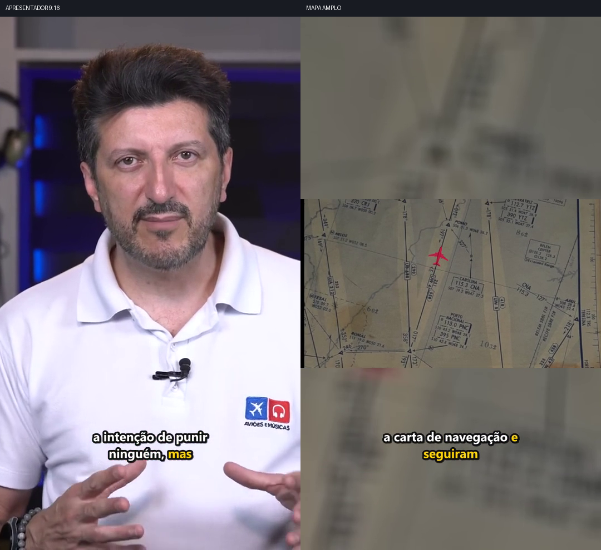

# Stories: diagn?stico e duas pr?vias para aprova??o

15/10/2026 ? Fase 1 conclu?da. Integra??o ao fluxo normal aguardando aprova??o do usu?rio.

## Causa encontrada

Os 16 Stories est?o corretamente em `AUTO_CONSERVADOR`. O snapshot do pacote parcial, por?m, tem zero linhas de timeline, cenas, observa??es de pessoas, frames e Director. `conservative_camera` escolheu o fallback; esse plano foi persistido e o render normal o reutiliza. O caminho dos Stories n?o chama o refinador dos Reels nem consulta suas medi??es locais. A melhoria anterior ficou acess?vel pela revis?o expl?cita, sem ser incorporada ao fluxo normal.

O FFmpeg executa o plano recebido. Nas novas revis?es isoladas, o plano adaptativo persistido tem o mesmo hash do plano entregue ? constru??o dos filtros e do plano gravado no render; o crop aparece no MP4. N?o foi identificado descarte das decis?es na constru??o dos filtros destes dois casos.

Existem observa??es e Director completos no diret?rio can?nico da mesma fonte. Eles n?o foram incorporados ao projeto persistido. O seletor da GUI vale para uma pr?xima importa??o; reabrir/importar a mesma proposta preserva o projeto antigo. H? ainda o limite de 256 MiB do leitor gen?rico para um diret?rio com cerca de 1,9 GB e o limiar global de 80% de cobertura do Director, que impede aproveitar intervalos certificados em cenas h?bridas. [Auditoria detalhada com caminhos e linhas](AUDITORIA_ROUTING_STORIES.md).

## Assistir ?s duas pr?vias

- [Lito preenchendo 9:16, zoom suave ? 9,34 s](PREVIA_LITO_9x16.mp4). Trecho da nova revis?o do Story 16, fonte aproximadamente 2029,78?2039,12 s. O recorte mostra rosto e busto; n?o ? certifica??o de todos os gestos ou da extens?o inteira dos bra?os.
- [Mapa com conte?do e avi?o preservados ? 26,06 s](PREVIA_MAPA_AMPLO.mp4). Nova revis?o do Story 2. Mant?m a imagem ampla quando faltam coordenadas espaciais revisadas que autorizem crop do mapa.

As duas pr?vias integrais, com t?tulos originais, tamb?m est?o dispon?veis:

| Caso | Pr?via integral nova | Crop no plano | Zoom |
| --- | --- | --- | --- |
| apresentador | [MP4](duas_previas/review_project/serie_s03/016_PROP_f47b1a26cfc3a496c457c437/ba9f93d3f025f5e8/preview/PREVIEW_540x960.mp4) | 14.18?24.19 s do Story | 1,000 ? 1,035, com easing |
| mapa_rota | [MP4](duas_previas/review_project/serie_s01/002_PROP_0cd8967b4785b114a6b605c0/48131feec2fa4035/preview/PREVIEW_540x960.mp4) | Fonte ampla por intervalo | Sem zoom for?ado |

O trecho curto do apresentador foi extra?do dos frames j? legendados da nova pr?via integral, com corte t?cnico sincronizado de ?udio e v?deo. N?o houve regenera??o de legendas nessa extra??o. O t?tulo aparece nos cinco segundos iniciais da pr?via integral, fora desse trecho curto. As janelas editoriais dos Stories n?o foram alteradas.

## Verifica??o

- **150 testes passaram e 1 foi ignorado** por falta de privil?gio para criar symlink Windows. O teste real de junction passou. [JUnit](pytest_phase1.xml).
- Nas duas pr?vias integrais novas, ?udio PCM, bytes de ASS/SRT, t?tulo PNG e digest da timeline can?nica s?o id?nticos ?s respectivas pr?vias atuais. IDs, ordem e intervalos tamb?m foram conferidos.
- Os filtros adaptativos recebem o plano novo corretamente. O hash do plano persistido, do input para `_base_cmd` e do `camera_plan.json` do MP4 ? o mesmo em cada caso. [Rastreamento e filtros](duas_previas/VALIDACAO_STORY_CAMERA_ROUTING.json).
- As duas pr?vias de aprova??o somam **849 frames decodificados**, sem faixas pretas uniformes detectadas nas bordas. [Auditoria visual](VISUAL_PREVIEWS_AUDIT.json).
- **2.344/2.344 arquivos protegidos** em output, .cache e source_cache permanecem id?nticos ao baseline desta tarefa. A fonte original externa tamb?m manteve o SHA256. [Confer?ncia ap?s as pr?vias](protected_after_demos.json).
- Os **147 arquivos preexistentes de c?digo/configura??o/testes e seus 147 backups** permanecem id?nticos. Nesta fase foram adicionados apenas um script de demonstra??o, seus testes e relat?rios. Nenhum m?dulo de produ??o foi alterado. [Verifica??o](code_integrity_phase1.json).

Os 8 Reels atuais, os 16 Stories atuais (incluindo o Story 6), as revis?es antigas e as aprova??es foram somente lidos. N?o houve CURAR, Qwen, transcri??o, detec??o nova, lote completo, limpeza destrutiva, commit ou push. Nenhuma demonstra??o foi aprovada automaticamente.

## Integra??o preparada e limite desta fase

[Patch proposto, n?o aplicado](PATCH_PROPOSTO_NAO_APLICADO.diff) ? [valida??o isolada da proposta](PATCH_PROPOSTO_VALIDACAO.json). O patch passou no `git apply --check` sem ser aplicado. Seus 12 testes em c?pia tempor?ria s?o distintos da execu??o do c?digo instalado e n?o substituem os testes da integra??o futura.

A proposta m?nima acrescenta v?nculos expl?citos Story ? evid?ncia existente e uma nova revis?o de c?mera, com dry-run e hashes. Ela n?o muda projetos antigos durante reabertura/render. O leitor can?nico seletivo e a opera??o correspondente na GUI est?o especificados na auditoria para a fase seguinte, ap?s sua aprova??o dos enquadramentos.

Os caches de Reels cobrem seis Stories integralmente, dois parcialmente e oito n?o s?o cobertos. Os metadados can?nicos existentes ser?o necess?rios para ampliar a cobertura sem analisar novamente a m?dia. Cada intervalo dever? justificar seu recorte; cenas sem evid?ncia segura continuam amplas. N?o se deve descartar caixas do corpo ou inventar coordenadas para aumentar a quantidade de crops.

Conforme solicitado, a integra??o ao fluxo normal dos 16 Stories ainda **n?o foi aplicada**. Ap?s aprova??o visual, ela deve criar novas revis?es e preservar as 16 pr?vias e os 8 Reels atuais; n?o dever? disparar o lote inteiro.

## Organiza??o e prote??o de output

[Relat?rio de prote??o e organiza??o](PROTECAO_OUTPUT.md) ? [invent?rio atual e 24 m?dias verificadas](OUTPUT_AUDIT.json) ? [matriz dos 16 Stories](STORIES_ROUTING_MATRIX.json) ? [duplicatas comprovadas, todas preservadas](DUPLICATAS_COMPROVADAS.json).

A auditoria confirmou 16/16 pr?vias atuais e 8/8 Reels atuais com hashes v?lidos, al?m das revis?es hist?ricas. A pol?tica de limpeza retornou zero arquivos remov?veis nas ?rvores protegidas. Nenhuma duplicata foi removida ou consolidada. A origem do incidente antigo de output vazio continua indeterminada.
